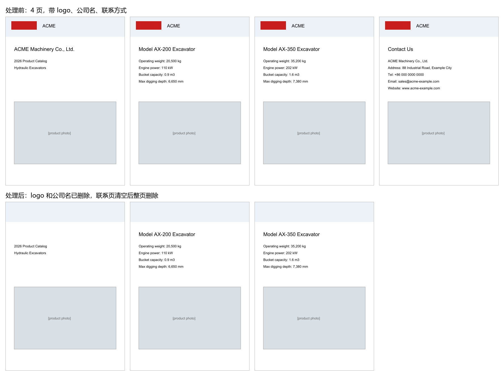

# DocStudio · 外贸文档翻译与去品牌工具

外贸公司从供应商拿到的 PDF 报价单和产品目录，直接转给海外客户会暴露供应商身份。DocStudio 把它们处理成可以直接发给客户的版本：翻译成外文，删掉供应商的 logo、公司名、联系方式和销售渠道，同时保留原版面、产品图和参数。已在外贸公司实际业务中使用。



## 功能与亮点

- **版面保真翻译**：用 PyMuPDF 读取 PDF 的矢量表格线，按行、单元格聚合后整格翻译；删除原文时只删文字、保留图片和线条，按单元格大小自适应字号回填。
- **术语库**：`glossary.json` 整句命中时直接使用锁定译法、不调用模型；句中出现的术语作为硬约束注入提示词，保证同一产品名在全文译法一致。
- **自动去品牌**：同一图片跨 3 页以上且中位面积小于 6% 判定为 logo 并删除；品牌词、公司名和联系信息用 redaction 真删除；页面分类器把企业宣传页、联系页、空页标为建议删除，交给人工确认。
- **视觉模型辅助**：图片型目录由通义千问视觉模型标出品牌区域、给出删页建议；可选本地 LaMa 图像修复擦除照片上的厂标。
- **导出前自检**：统计残留品牌词，残留不为 0 时提示不要外发。
- **实测效果**：一份 29 页的厂家英文目录，处理后得到 13 页纯产品目录，品牌残留为 0，直接用于对客报价。

技术栈：Python / PyMuPDF / FastAPI / pywebview 桌面窗口 / 通义千问（翻译与视觉）/ LaMa（可选）。

## 安装

Windows 安装包在 [Releases](../../releases/latest) 里：下载 `DocStudio-Setup-1.0.0.exe` 安装，装完即可使用，不需要另外安装 Python。安装器会创建开始菜单和桌面快捷方式，装完自动跑一次隐藏自检，失败时提示查看 `%TEMP%\DocStudio-self-test.log`。

安装包不含本地 LaMa 图像修复（依赖 `torch`，体积以 GB 计）；需要时按下面的源码方式运行，或在源码环境另装。

## 环境要求

- Windows（启动脚本为 `.cmd`，桌面窗口由 pywebview 提供；未在其他平台验证）。
- Python 3，依赖见 `requirements.txt`：pymupdf、fastapi、uvicorn、pywebview、pillow、numpy、requests、openai、python-multipart。仓库未固定版本（无 `pyproject.toml`、`.python-version`，requirements 也无版本范围）。
- 翻译与视觉功能调用阿里云通义千问，需要联网。
- 可选：照片去厂标需额外安装 `torch` 与 `simple-lama-inpainting` 及对应模型，首次使用会下载约 200MB。

## 快速开始

1. 创建虚拟环境并安装依赖：

   ```
   python -m venv .venv
   .venv\Scripts\pip install -r requirements.txt
   ```

2. 配置通义千问 API Key。代码读取环境变量 `DASHSCOPE_API_KEY`：双击启动桌面窗口时，需把它写入系统环境变量；只在同一 PowerShell 会话里临时设置的话，随后也要从该会话启动程序：

   ```
   $env:DASHSCOPE_API_KEY = "sk-..."
   ```

   视觉模型默认 `qwen3.6-plus`，可用环境变量 `DOC_QA_VL_MODEL` 覆盖。

3. 启动桌面窗口：双击 `启动文档工具.cmd`，或在仓库目录执行 `.venv\Scripts\python.exe desktop_app.py`。启动脚本使用本目录 `.venv`，并把 LaMa/torch 的模型缓存放在程序所在磁盘的 `torch-cache` 与 `hf-cache` 目录。

具体操作步骤见 [使用说明.md](使用说明.md)。

## 命令行用法（debrand.py）

```
python debrand.py --in <输入.pdf> --out <输出.pdf> --brand ACME [ACME ...] \
    [--remove-xref 10 26]   # 视觉层认定的一次性图对象（如封面水印）
    [--auto-drop]           # 自动删除分类器判为 drop 的页（企业宣传/联系/空页）
    [--drop-page 3 22 23]   # 手动整页删除（可补删 review 页，可与 --auto-drop 叠加）
    [--no-contact]          # 不删联系信息
    [--review <目录>]       # 逐页渲染 PNG 供肉眼终审
```

品牌词大小写不敏感（给 `Acme` 自动覆盖 ACME/acme）。另有 `--scrub` / `--scrub-file` 按关键词整行脱敏识别线索，默认流程不使用。

## 目录结构

```
desktop_app.py       桌面入口：本地起 FastAPI，再用 pywebview 开窗口
desktop_api.py       桌面版本地无鉴权 API
server.py            FastAPI 服务入口（翻译 / 去品牌 / 结构化等端点）
debrand.py           命令行去品牌入口
engine*.py、risk_review.py   抽取、翻译、回填、视觉复核、残留自检等模块
glossary.json        中英术语库
static/、docs/       桌面 UI（desktop.html / desktop.js）、截图与设计记录
使用说明.md、requirements.txt、启动文档工具.cmd   操作说明、Python 依赖、Windows 启动脚本
DocStudio.spec、installer/   PyInstaller 打包配置与 Inno Setup 安装脚本
```

## 已知边界

- 句中残留：删掉品牌词后可能留下 “Group has...” 这类略生硬的英文碎句，由翻译/润色层处理，不属于去品牌层职责。
- 证书照片里烤进的公司名：当前版本不处理，需要视觉模型 + LaMa 才能擦除。
- 一次性水印、异形 logo：自动层不会盲删以免误伤内容，需人工或视觉层用 `--remove-xref` 指定 xref。
- 翻译与去品牌结果请在交付前人工核对一遍。

## 文档

- [docs/DESIGN.md](docs/DESIGN.md)：开发过程设计记录（页面分类器、删页哲学、已知边界等），可能已过时。
- [使用说明.md](使用说明.md)：桌面版操作步骤。
- [PLAN_一体化整合.md](PLAN_一体化整合.md)、[PLAN_阶段3_结构化入KB.md](PLAN_阶段3_结构化入KB.md)：早期规划记录。

## 许可证与免责声明

本项目以 GNU AGPL-3.0 发布，见 [LICENSE](LICENSE)。项目使用 PyMuPDF（AGPL-3.0），对外分发本工具或其修改版时需同样遵守 AGPL-3.0；如需闭源分发，请自行获取 PyMuPDF 的商业许可。

工具按现状提供；翻译结果与去品牌效果需人工复核，交付前请自行确认内容合规。
